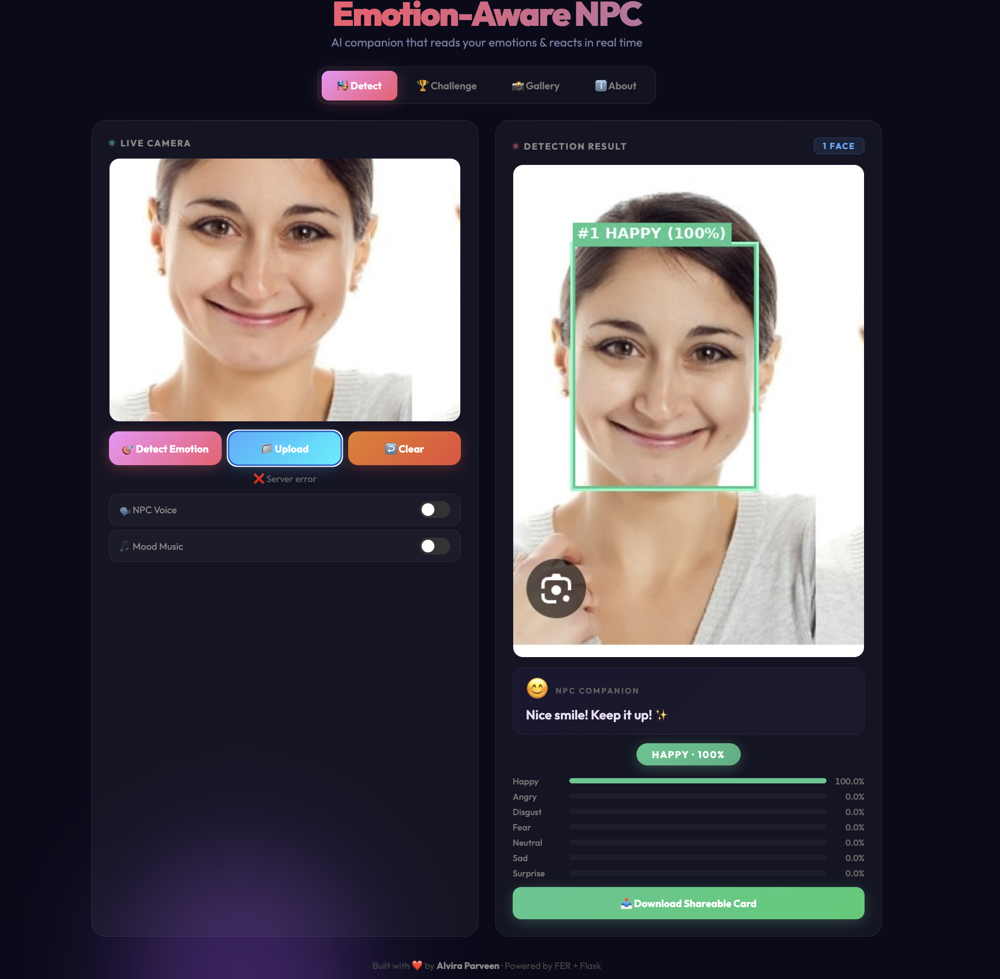
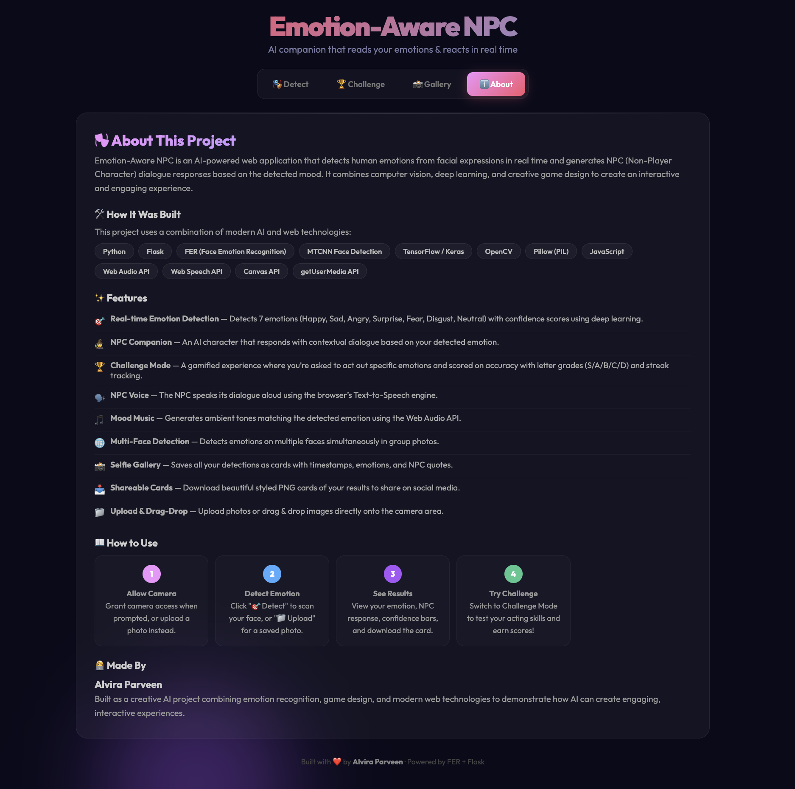

# 🎭 Emotion-Aware NPC System

This project demonstrates **how AI-powered NPCs can detect human emotions in real time using a webcam feed and respond using speech and generates NPC (Non-Player Character) dialogue responses based on the detected mood.**. It showcases how emotional intelligence can be integrated into virtual agents — an essential innovation for metaverse avatars, gaming, and human-AI interaction systems.


---

## 🚀 Live Demo : **[emotion-aware-npc](https://huggingface.co/spaces/Alvira-14/emotion-aware-npc)**

---

## 📸 Screenshots

### Home Page


### About 


---

# 🔥 Features

| Feature | Description |
|---------|-------------|
| 🎯 **Emotion Detection** | Detects 7 emotions (Happy, Sad, Angry, Surprise, Fear, Disgust, Neutral) with confidence scores |
| 🧙 **NPC Companion** | AI character that responds with contextual dialogue based on your mood |
| 🏆 **Challenge Mode** | Gamified emotion matching with grades (S/A/B/C/D) and streak tracking |
| 🗣️ **NPC Voice** | NPC speaks dialogue aloud using browser Text-to-Speech |
| 🎵 **Mood Music** | Generated ambient tones matching each emotion via Web Audio API |
| 🌐 **Multi-Face Detection** | Detects emotions on multiple faces simultaneously |
| 📸 **Selfie Gallery** | Session history with timestamps, emotions, and NPC quotes |
| 📥 **Shareable Cards** | Download styled PNG cards of your results for social media |
| 📁 **Upload & Drag-Drop** | Upload photos or drag & drop images directly |
| ↩️ **Clear/Reset** | Go back to webcam without refreshing the page |
| ℹ️ **About & Guide** | Built-in project info and usage instructions |

---

# 🧠 Technologies Used

- **Backend:** Python, Flask
- **AI/ML:** FER (Facial Emotion Recognition), MTCNN, TensorFlow/Keras, OpenCV
- **Frontend:** Vanilla JavaScript, CSS (Glassmorphism), HTML5
- **Browser APIs:** getUserMedia, Web Speech API, Web Audio API, Canvas API
- **Image Processing:** Pillow (PIL)

---

# 🧩 Project Structure

```
emotion_npc/
├── web_app.py              # Flask backend + emotion detection API
├── templates/
│   └── index.html          # Full frontend (HTML/CSS/JS)
├── modules/                # Multimodal emotion recognition & NPC modules
│   ├── text_emotion.py     # Text emotion recognition
│   ├── voice_emotion.py    # Voice acoustic emotion recognition
│   ├── fusion.py           # Weighted decision fusion
│   ├── llm_npc.py          # Generative AI NPC dialogue
│   └── npc_adapter.py      # Adaptive Metaverse climate & TTS
├── npc_emotion.py          # Original OpenCV-based script
├── requirements.txt        # Python dependencies
└── README.md               # This file
```

---

# 🚀 How to Run

**1️⃣ Clone the repository**
```bash
git clone https://github.com/Alvira-Parveen/Emotion-Aware-NPC-Project.git
cd Emotion-Aware-NPC-Project
```

**2️⃣ Create and activate virtual environment**
```bash
python3 -m venv venv
source venv/bin/activate          # On macOS/Linux
```

**3️⃣ Install dependencies**
```bash
pip install -r requirements.txt
```

**4️⃣ Run the project**
```bash
python web_app.py
```

---

## 📖 How to Use

1. **Allow Camera** — Grant camera access when prompted, or use the upload button instead
2. **Detect Emotion** — Click "🎯 Detect" to scan your face from the webcam
3. **Upload Photo** — Click "📁 Upload" to analyze a saved photo
4. **View Results** — See your emotion, NPC dialogue, confidence bars, and badge
5. **Download Card** — Click "📥 Download Shareable Card" to save a styled PNG
6. **Challenge Mode** — Switch to "🏆 Challenge" tab to test your acting skills
7. **Gallery** — Check the "📸 Gallery" tab for your session history
8. **Voice & Music** — Toggle on NPC Voice and Mood Music for the full experience

---


# 🔮 Future Improvements

- Animated 2D/3D avatars
- Multifacial detection
- VR/metaverse integration
- Emotion memory tracking

---

# 🎯 Outcome

- Successful demonstration of AI-driven emotional interaction
- Fully working prototype
- Valid implementation under “AI-Driven Innovation in the Metaverse”

---

# 📊 Results & Conclusion

- The system successfully detects user facial emotions in real-time using the webcam.
- NPC responses are emotion-aligned and spoken clearly via voice output, enhancing user interaction.
- The bounding box and emotion label display help visually confirm detection.
- Response timing is managed using a cooldown mechanism, which prevents over-sensitivity or rapid speech.
- Works smoothly for front-facing users under normal lighting conditions, showing practical performance.
- The project effectively demonstrates how AI-driven emotional intelligence can be integrated into virtual NPCs to provide a more natural and immersive interaction.

---

# 🌟 Real-Time Multimodal Extensions (B.Tech PBL-3)

As part of the research project **"AI in Metaverse: Real-Time Multimodal Emotion-Aware Adaptive Metaverse Using Artificial Intelligence"**, the following advanced multimodal features and architectures were implemented:

- **🎙️ Voice Emotion Recognition (`modules/voice_emotion.py`):**
  - Real-time acoustic emotion analysis using prosodic energy, pitch, and zero-crossing dynamics with SpeechBrain / Wav2Vec2 support.
  - In-browser 3-second audio recording via the Web Audio API with secure in-memory processing.

- **💬 Text Emotion Recognition (`modules/text_emotion.py`):**
  - Ekman 7-class emotion classification across text inputs (Happy, Sad, Angry, Surprise, Fear, Disgust, Neutral).
  - Lexical and VADER sentiment analysis with HuggingFace DistilRoBERTa model pipeline compatibility.

- **🌐 Weighted Decision-Level Fusion (`modules/fusion.py`):**
  - Probability-level decision fusion combining Face ($w=0.50$), Text ($w=0.30$), and Voice ($w=0.20$).
  - Dynamic weight re-normalization and uncalibrated score safeguards when any modality is absent.

- **🤖 Generative AI NPC Companion Layer (`modules/llm_npc.py`):**
  - Emotion-aware generative dialogue synthesis supporting Google Gemini and OpenAI APIs, with non-blocking fallback to an emotionally curated dialogue bank.
  - Component-wise latency measurement (Face, Text, Voice, Fusion, and LLM response times in ms).

- **🌌 Adaptive Metaverse Climate & Environment State (`modules/npc_adapter.py`):**
  - Environmental atmospheric adaptation (*Energetic Sunrise*, *Emerald Aurora*, *Quiet Haven*, *Harmonic Nexus*, *Thunderous Forge*, *Verdant Sanctuary*).
  - Dynamic Web Speech TTS pacing (adaptive pitch, rate, and style) reacting immediately to fused emotion states.

---

## 👩‍💻 Author
**Name**: ALVIRA PARVEEN  
🔗 [LinkedIn](https://www.linkedin.com/in/alvira-parveen-78022536b)  
🌐 [GitHub](https://github.com/Alvira-Parveen)

---

## 📄 License

This project is licensed under the MIT License — see the [LICENSE](LICENSE) file for details.

---

⭐ If you found this project useful, consider giving it a star.
